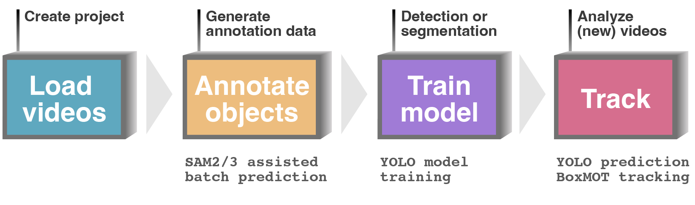

**OCTRON** is a pipeline built on [napari](https://www.napari.org) that enables segmentation, detection, and tracking of animals in behavioral setups. It helps you to create rich annotation data that can be used to train your own machine learning segmentation and detection models. This enables dense quantification of animal behavior across a wide range of species and video recording conditions.
<br><br>
OCTRON is built on [Napari](https://www.napari.org), [Segment Anything (SAM2/SAM3)](https://aidemos.meta.com/), [YOLO](https://www.ultralytics.com/), [BoxMOT](https://github.com/mikel-brostrom/boxmot) and 💜.

Main repository: [OCTRON-GUI](https://github.com/OCTRON-tracking/OCTRON-GUI)

!!! info "New preprint version available — v2"
    We have just uploaded a revised version of the OCTRON preprint! [Read version 2 on bioRxiv](https://www.biorxiv.org/content/10.64898/2025.12.20.695663v2).

The main steps implemented in OCTRON typically include: Loading video data from behavioral experiments, annotating frames with SAM2/SAM3 assistance to create training data, training machine learning models for detection or segmentation, and finally applying these models to new data for automated tracking.
<br>
<br>

<br>
<video width="100%" muted controls poster="assets/videos/poster_frame.jpg" style="display: block; margin-left: auto; margin-right: auto;">
  <source src="assets/videos/MAIN.mp4" type="video/mp4">
  Your browser does not support the video tag.
</video>

!!! info "Support" 
    If you find this project helpful, consider supporting us:<br>
    - [GitHub Sponsors](https://github.com/sponsors/OCTRON-tracking)<br>
    - [Buy Me a Coffee](https://buymeacoffee.com/octron)


!!! quote "How to cite"
    Using OCTRON for your project? Please cite this paper to share the word!
    [Read the newly uploaded version 2 on bioRxiv](https://www.biorxiv.org/content/10.64898/2025.12.20.695663v2).
    <br>
    Jacobsen, R. I., van Eekelen, N. M., Humphrey, L., Renton, J., van Rooij, E., Rivera, J., Arenas, O. M., Lumpkin, E. A., Maccuro, S., Buresch, K. C., Seuntjens, E., & Obenhaus, H. A. (2025). OCTRON - a general purpose segmentation and tracking pipeline for behavioral experiments. *bioRxiv*, 2025.12.20.695663. [https://doi.org/10.64898/2025.12.20.695663](https://doi.org/10.64898/2025.12.20.695663)
    ```{bibtex}
    @ARTICLE{Jacobsen2025-qq,
      title    = "{OCTRON} - a general purpose segmentation and tracking pipeline
                  for behavioral experiments",
      author   = "Jacobsen, Ragnhild Irene and van Eekelen, Nadia M and Humphrey,
                  Laurel and Renton, Johnston and van Rooij, Elke and Rivera, Jason
                  and Arenas, Oscar M and Lumpkin, Ellen A and Maccuro, Sofia and
                  Buresch, Kendra C and Seuntjens, Eve and Obenhaus, Horst A",
      journal  = "bioRxiv",
      pages    = "2025.12.20.695663",
      doi      = "10.64898/2025.12.20.695663",
      url      = "https://www.biorxiv.org/content/10.64898/2025.12.20.695663v2",
      abstract = "OCTRON is a pipeline for markerless segmentation and tracking of
                  animals in behavioral experiments. By combining Segment Anything
                  Models (SAM 2) for rapid annotation, YOLO11 models for training,
                  and state-of-the-art multi-object trackers, OCTRON enables
                  unsupervised segmentation and tracking of multiple animals with
                  complex, deformable body plans. We validate its versatility across
                  species - from transparent marine annelids to camouflaging
                  cuttlefish - demonstrating robust, general-purpose applicability
                  for behavioral analysis.",
      month    =  dec,
      year     =  2025,
      language = "en"
    }
    ```
<br>
<hr>

!!! info "Attributions"
    - Interface button and icon images were created by user [Arkinasi](https://thenounproject.com/browse/collection-icon/marketing-agency-239829/) from Noun Project (CC BY 3.0)
    - Logo font: [datalegreya](https://datalegreya.figs-lab.com/?lang=en)
    - OCTRON's viewer and graphical interface are built on [napari](https://napari.org), developed by the napari contributors. Software citation: [napari: a multi-dimensional image viewer for Python](https://doi.org/10.5281/zenodo.3555620).
    - OCTRON mp4 video reading is based on [napari-pyav](https://github.com/danionella/napari-pyav)
    - Annotation and object-label colour maps are provided by [CMasher](https://github.com/1313e/CMasher):
    ```{bibtex}
    @article{vanderVelden2020cmasher,
      author = {van der Velden, Ellert},
      title = {{CMasher}: Scientific colormaps for making accessible, informative and 'cmashing' plots},
      journal = {Journal of Open Source Software},
      volume = {5},
      number = {46},
      pages = {2004},
      year = {2020},
      doi = {10.21105/joss.02004},
      url = {https://doi.org/10.21105/joss.02004}
    }
    ```
    - OCTRON model training and prediction use [Ultralytics YOLO](https://github.com/ultralytics/ultralytics), including the YOLO11 model family:
    ```{bibtex}
    @software{ultralytics_yolo,
      author = {Jocher, Glenn and Qiu, Jing and Chaurasia, Ayush},
      title = {Ultralytics YOLO},
      year = {2023},
      url = {https://github.com/ultralytics/ultralytics},
      license = {AGPL-3.0}
    }
    ```
    - OCTRON annotation uses the Segment Anything model family. The original SAM work is credited below:
    ```{bibtex}
    @article{kirillov2023segany,
      title={Segment Anything},
      author={Kirillov, Alexander and Mintun, Eric and Ravi, Nikhila and Mao, Hanzi and Rolland, Chloe and Gustafson, Laura and Xiao, Tete and Whitehead, Spencer and Berg, Alexander C. and Lo, Wan-Yen and Doll{\'a}r, Piotr and Girshick, Ross},
      journal={arXiv:2304.02643},
      year={2023}
    }
    ```
    - SAM 2 / SAM 2.1 provide image and video segmentation:
    ```{bibtex}
    @article{ravi2024sam2,
      title={SAM 2: Segment Anything in Images and Videos},
      author={Ravi, Nikhila and Gabeur, Valentin and Hu, Yuan-Ting and Hu,
              Ronghang and Ryali, Chaitanya and Ma, Tengyu and Khedr,
              Haitham and R{\"a}dle, Roman and Rolland, Chloe and Gustafson,
              Laura and Mintun, Eric and Pan, Junting and Alwala, Kalyan
              Vasudev and Carion, Nicolas and Wu, Chao-Yuan and Girshick,
              Ross and Doll{\'a}r, Piotr and Feichtenhofer, Christoph},
      journal={arXiv preprint arXiv:2408.00714},
      url={https://arxiv.org/abs/2408.00714},
      year={2024}
    }
    ```
    - OCTRON's SAM 2 HQ option uses [HQ-SAM 2](https://github.com/SysCV/sam-hq/tree/main/sam-hq2), which extends the HQ-SAM approach to SAM 2. Its authors recommend the following HQ-SAM citation, in addition to crediting SAM 2:
    ```{bibtex}
    @inproceedings{sam_hq,
        title={Segment Anything in High Quality},
        author={Ke, Lei and Ye, Mingqiao and Danelljan, Martin and Liu, Yifan and Tai, Yu-Wing and Tang, Chi-Keung and Yu, Fisher},
        booktitle={NeurIPS},
        year={2023}
    }
    ```
    - SAM 3 provides concept-prompted segmentation:
    ```{bibtex}
    @misc{carion2025sam3segmentconcepts,
      title={SAM 3: Segment Anything with Concepts}, 
      author={Nicolas Carion and Laura Gustafson and Yuan-Ting Hu and Shoubhik Debnath and Ronghang Hu and Didac Suris and Chaitanya Ryali and Kalyan Vasudev Alwala and Haitham Khedr and Andrew Huang and Jie Lei and Tengyu Ma and Baishan Guo and Arpit Kalla and Markus Marks and Joseph Greer and Meng Wang and Peize Sun and Roman Rädle and Triantafyllos Afouras and Effrosyni Mavroudi and Katherine Xu and Tsung-Han Wu and Yu Zhou and Liliane Momeni and Rishi Hazra and Shuangrui Ding and Sagar Vaze and Francois Porcher and Feng Li and Siyuan Li and Aishwarya Kamath and Ho Kei Cheng and Piotr Dollár and Nikhila Ravi and Kate Saenko and Pengchuan Zhang and Christoph Feichtenhofer},
      year={2025},
      eprint={2511.16719},
      archivePrefix={arXiv},
      primaryClass={cs.CV},
      url={https://arxiv.org/abs/2511.16719}, 
    }
    ```
    - OCTRON multi-object tracking is provided by [BoxMOT](https://github.com/mikel-brostrom/boxmot):
    ```{bibtex}
    @software{boxmot,
      author = {Broström, Mikel and Kozak, Mikhail},
      title = {{BoxMOT}: pluggable state-of-the-art multi-object tracking modules},
      year = {2023},
      url = {https://github.com/mikel-brostrom/boxmot},
      license = {AGPL-3.0}
    }
    ```
   


<br>
<br>
